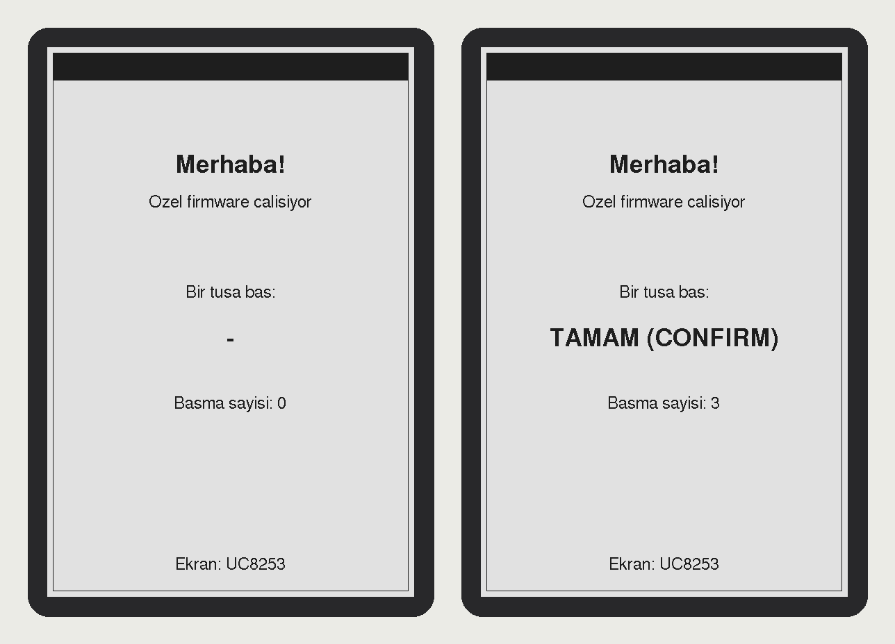

# Xteink X3 — özel firmware

Adım 1: "Merhaba" ekranı + buton testi. Dikey ekranda karşılama yazısı çıkar,
bastığın her tuşun adı ekranda görünür (fiziksel tuşları eşlemek için).
Ekranın üst kenarında kalın siyah bir şerit var: yön doğru mu diye kontrol et.

Donanım katmanı: [FreeInk SDK](https://github.com/Free-Ink/freeink-sdk) (MIT).
Repoya dahil değil, derlemeden önce bu klasöre klonlanır.



## Hazır imajı yükleme (Windows)

`release/x3-merhaba-v0.1.bin` dosyasını esptool klasörüne kopyala, sonra:

```bash
esptool --port COM14 --baud 921600 write-flash 0 x3-merhaba-v0.1.bin
```

## Ekran önizlemesi (cihazsız)

`tools/preview/` aynı `src/ui.cpp` çizim kodunu PC'de çalıştırıp PGM görüntü üretir:

```bash
tools/preview/build.sh /tmp/x3-preview
```

## Derleme

```bash
git clone https://github.com/Free-Ink/freeink-sdk.git freeink-sdk
git -C freeink-sdk checkout 5095ddddb301f92d40dcb884db8fb436446022ea
pio run -e x3
```

## Fabrika firmware'ine dönüş

Orijinal 16 MB yedek (`x3-yedek.bin`) ile:

```bash
esptool --port COM14 --baud 921600 write-flash 0 x3-yedek.bin
```
