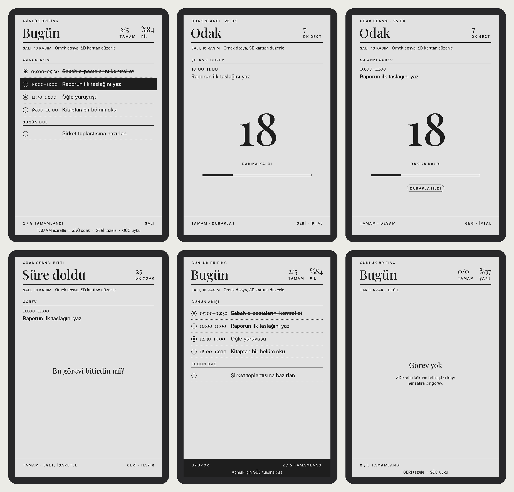

# Xteink X3 — "Bugün" özel firmware

Günlük brifing, 25 dakikalık odak sayacı, kitap rafı ve e-kitap okuyucu,
"Sabah Brifingi" tasarım diliyle (Playfair Display başlıklar, büyük harf
etiketler, ince ayraçlar). Brifing SD karttaki `brifing.txt` dosyasından,
kitaplar `/kitaplar` klasöründen okunur; ikisi de telefondan Wi-Fi ile
güncellenir. Uykuda ekranda bir kütüphane ödünç kartı durur.



## Kullanım

| Ekran        | Tuş              | Ne yapar                              |
|--------------|------------------|---------------------------------------|
| Liste        | YUKARI / AŞAĞI   | Görev seç                             |
| Liste        | TAMAM            | Bitti / bitmedi işaretle (SD'ye yazar)|
| Liste        | SAĞ              | Seçili görev için 25 dk odak başlat   |
| Liste        | GERİ             | Kitaplık (raf)                        |
| Liste        | SOL              | Wi-Fi aktarım ekranı                  |
| Liste        | GÜÇ              | Uyku (3 dk dokunulmazsa kendiliğinden)|
| Kitaplık     | SOL / SAĞ        | Önceki / sonraki kitap                |
| Kitaplık     | YUKARI / AŞAĞI   | Üst / alt raf                         |
| Kitaplık     | TAMAM            | Kitabı aç (kaldığın yerden); "+ Kitap ekle" sırtında Wi-Fi |
| Kitaplık     | GERİ             | Brifinge dön                          |
| Okuyucu      | SAĞ / AŞAĞI      | Sonraki sayfa                         |
| Okuyucu      | SOL / YUKARI     | Önceki sayfa                          |
| Okuyucu      | GERİ             | Rafa dön (yer kaydedilir)             |
| Wi-Fi        | GERİ             | Wi-Fi'ı kapat, geldiğin ekrana dön    |
| Odak         | TAMAM            | Duraklat / devam et                   |
| Odak         | GERİ             | İptal, listeye dön                    |
| Süre doldu   | TAMAM / GERİ     | Görevi bitti işaretle / işaretleme    |

Tuşların cihazdaki yerleri: [docs-hardware.md](docs-hardware.md).

## Kitaplık ve okuyucu

- Raf: kitapların sırtları yan yana, başlık sırtta aşağıdan yukarıya. Sırt
  kalınlığı kitabın boyutuna göre; okunan kitaplarda ayraç kurdelesi var,
  seçili sırt siyah. Altta seçili kitabın adı, yazarı, yüzdesi ve başlama günü.
- Okuyucu: EPUB (DRM'siz) ve TXT; Literata 21 px, iki yana yaslı, Türkçe ve
  İngilizce heceleme. Altta bölüm adı, sayfa ve yüzde. Her kitabın kaldığı
  yer, ilk açıldığı gün ve son okunma zamanı `/kitaplar/.x3/<id>/durum.txt`
  dosyasında; sayfa önbelleği de aynı klasörde (ilk açılışta bölüm başına
  birkaç saniye sürer).
- Uyku: "GK'nin Kitaplığı" ödünç kartı; okunan kitaplar en son okunandan
  başlayarak, başlama tarihi damgası ve yüzdesiyle.

## Wi-Fi aktarım

Listede **SOL** tuşuna bas (ya da kitaplıkta "+ Kitap ekle" sırtını seç). Cihaz kendi Wi-Fi ağını açar (`GK's Xteink X3`, şifre
her seferinde yeni, ekranda yazar) ve bir QR kod gösterir:

1. Telefon kamerasıyla QR kodu okut (ya da ağa elle bağlan).
2. Tarayıcıda `http://192.168.4.1` adresini aç.
3. Sayfa açılınca cihazın saati telefonun saatiyle ayarlanır.
4. **Kitaplar**: "Kitap ekle" ile bir ya da birkaç EPUB/TXT yükle, istemediğini sil.
5. `brifing.txt` içeriğini düzenle, yapıştır ya da dosyadan yükle; **Kaydet**.
   Cihaz SD karta yazar ve ekranı yeniler.

Ev Wi-Fi şifresi gerekmez. GERİ ile ya da 10 dakika kullanılmazsa kapanır.

## brifing.txt

SD kartın kök dizininde, UTF-8 (yoksa eski adı `gorevler.txt` okunur; ikisi de
yoksa örnek dosya oluşturulur). En fazla 30 görev, 3 gösterge, 4 bölüm:

```
# Bu satır yorum
ust: Günlük brifing
baslik: Sabah Brifingi
alt: Sprint haftası H6
gosterge: Hava | 12 °C | parçalı bulutlu
gosterge: Enerji | 70 · dengeli | HRV 40 ms
## Günün akışı
[x] 09:00-09:30 | Sabah e-postaları
[ ] 10:00-11:00 | Raporun ilk taslağı
## Bugün due
[ ] Toplantıya hazırlan
```

- `ust`, `baslik`, `alt`: başlığın üstü, başlık, tarihin yanındaki not.
- `gosterge`: `etiket | değer | ayrıntı` (ayrıntı isteğe bağlı).
- `## Ad`: bölüm başlığı; `[x]` tamamlanmış, `[ ]` açık; `saat | metin`
  saat sütununa yazılır.

## Tarih ve pil

Başlığın altında tarih ("SALI, 10 KASIM"), sağ üstte tamamlanan görev sayısı
ve pil yüzdesi görünür (şarj olurken "ŞARJ" yazar). Tarih cihazdaki saat çipinden (DS3231) okunur.
Saati ayarlamanın en kolay yolu Wi-Fi aktarım sayfasını açmak. Kart
okuyucun varsa SD kartın köküne `saat.txt` da koyabilirsin, içine şu anki
saati yaz:

```
10.11.2026 15:30
```

Cihaz bir sonraki açılışta saati ayarlar ve dosyayı siler. Dosya silinmediyse
biçim anlaşılmamıştır (`2026-11-10 15:30` biçimi de kabul edilir).

## Hazır imajı yükleme (Windows)

`release/x3-bugun-v0.9.4.bin` dosyasını esptool klasörüne kopyala, sonra:

```bash
esptool --port COM14 --baud 921600 write-flash 0 x3-bugun-v0.9.4.bin
```

## Fabrika firmware'ine dönüş

```bash
esptool --port COM14 --baud 921600 write-flash 0 x3-yedek.bin
```

## Geliştirme

Donanım katmanı [FreeInk SDK](https://github.com/Free-Ink/freeink-sdk) (MIT),
repoya dahil değil:

```bash
git clone https://github.com/Free-Ink/freeink-sdk.git freeink-sdk
git -C freeink-sdk checkout 5095ddddb301f92d40dcb884db8fb436446022ea
pio run -e x3
```

- `src/app.cpp` — ekran durumları ve tuş mantığı (donanımdan bağımsız)
- `src/tasks.cpp` — `brifing.txt` okuma/yazma
- `src/ui.cpp` — ekran çizimi; `src/text.cpp` — UTF-8 → font kodları
- `src/clock.cpp` — Türkçe tarih, `saat.txt` okuma
- `src/webpage.h` — Wi-Fi aktarım sayfası (HTML)
- `src/library.cpp` — raf modeli, kitap durum dosyası, sırt yerleşimi
- `src/reader/` — okuma motoru bağlantısı (FreeInkBook, düşük bellek profili),
  gömülü Literata fontları ve Türkçe heceleme (`tools/fontgen/build_book_fonts.sh`)
- `src/sd_storage.h` — kitap ve sayfa önbelleği için SD adaptörleri
- Okuyucu simülatörü (PC'de gerçek bir kitabı cihazdaki gibi sayfalar):
  `tools/reader-sim/build.sh /tmp/rs && /tmp/rs/reader-sim kitap.epub /tmp/rs/cache /tmp/rs/out 5`
- `src/fonts/` — Inter ve Playfair Display (SIL OFL 1.1) ile üretildi: `tools/fontgen/build_fonts.sh`
- Testler (PC'de): `tools/test/run.sh`
- Ekran önizlemesi (PC'de, cihazdaki çizim koduyla aynı): `tools/preview/build.sh /tmp/x3-preview [brifing.txt]`

## Üçüncü taraf içerik

- [FreeInk SDK](https://github.com/Free-Ink/freeink-sdk) (MIT): donanım katmanı ve FreeInkBook okuma motoru.
- Literata, Inter, Playfair Display: SIL Open Font License 1.1 (Google Fonts / rsms).
- Türkçe heceleme kalıpları: [hyph-utf8](https://github.com/hyphenation/tex-hyphen) `hyph-tr`, kendi lisansıyla.
